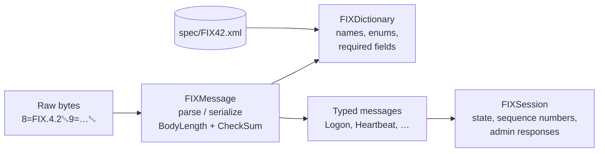

# FIXEngine


A FIX 4.2 engine written from scratch in C++20. It parses and serializes FIX
wire messages, validates them against the official XML dictionary, exposes
typed wrappers for session-level messages, and tracks session state and
sequence numbers.

## Features

- **Wire format:** parses `tag=value<SOH>` messages while preserving field
  order, and validates `BodyLength` and `CheckSum`.
- **Serialization:** builds outbound messages with recalculated `BodyLength`
  and `CheckSum`.
- **Dictionary validation:** loads the FIX 4.2 XML dictionary, resolves tag
  names and enum descriptions, and checks required header, body, and trailer
  fields for each `MsgType`.
- **Typed admin messages:** `Heartbeat`, `Logon`, `Logout`, `TestRequest`,
  `ResendRequest`, and `SequenceReset`.
- **Session layer:** session state, sequence-number tracking, TestRequest
  responses, Logout handling, and ResendRequest on sequence gaps.

## Architecture



## Demo

`examples/demo.cpp` parses a NewOrderSingle, validates it, and prints each
field with names resolved from the dictionary:

```text
$ ./build/fixengine_demo
BodyLength/CheckSum valid: yes
Dictionary valid:          yes

8   BeginString   FIX.4.2
9   BodyLength    118
35  MsgType       D (NEW_ORDER_SINGLE)
49  SenderCompID  ONIXS
56  TargetCompID  CME
34  MsgSeqNum     2
52  SendingTime   20240528-09:20:52.111
11  ClOrdID       983532-3
21  HandlInst     1 (AUTOMATED_EXECUTION_NO_INTERVENTION)
38  OrderQty      100
55  Symbol        NVDA
40  OrdType       1 (MARKET)
54  Side          1 (BUY)
60  TransactTime  20240528-09:20:52.004
10  CheckSum      017
```

## Usage

```cpp
#include "FIXDictionary.h"
#include "Logon.h"

std::string raw =
    "8=FIX.4.2\x01"
    "9=76\x01"
    "35=A\x01"
    "49=BuySide\x01"
    "56=SellSide\x01"
    "34=1\x01"
    "52=20190605-11:27:06.897\x01"
    "98=0\x01"
    "108=30\x01"
    "141=Y\x01"
    "10=008\x01";

Logon logon(raw);
FIXDictionary dictionary;

bool wireValid = logon.validate();
bool dictionaryValid = dictionary.validate(logon);

std::string heartbeatInterval = logon.getHeartBtInt();
```

## Building

Requires CMake 3.15+ and a C++20 compiler (tested with GCC and Clang).
[Catch2](https://github.com/catchorg/Catch2) and
[pugixml](https://github.com/zeux/pugixml) are fetched automatically.

```sh
cmake -S . -B build
cmake --build build -j
ctest --test-dir build --output-on-failure
```

Build options:

| Option | Default | Description |
|---|---|---|
| `FIXENGINE_WARNINGS_AS_ERRORS` | `OFF` | Treat compiler warnings as errors |
| `FIXENGINE_SANITIZE` | `OFF` | Build with AddressSanitizer and UndefinedBehaviorSanitizer |

CI builds with GCC and Clang using `-Werror`, runs the test suite under ASan
and UBSan, and checks formatting with `clang-format`.

## Project Layout

```text
src/        engine library (messages, dictionary, session)
examples/   demo program
tests/      Catch2 unit tests
spec/       FIX 4.2 XML dictionary
```

## Roadmap

- [x] Wire parsing, serialization, `BodyLength` / `CheckSum` validation
- [x] Dictionary-backed field names, enums, and required-field validation
- [x] Typed admin messages
- [x] Session state, sequence tracking, and gap detection
- [ ] Field type and enum domain validation with detailed errors
- [ ] Heartbeat scheduling and peer timeout handling
- [ ] Message store with resend and gap-fill replay
- [ ] TCP initiator, then acceptor
- [ ] Application messages (`NewOrderSingle`, `ExecutionReport`)

## Scope

FIXEngine is built to understand FIX in depth by implementing it directly,
layer by layer. It is not intended to replace production engines such as
QuickFIX.
